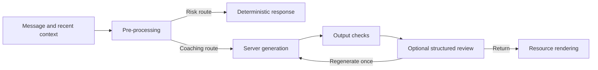

# Social Intelligence Engineering

Social Intelligence is an actively developed AI-assisted interpersonal coaching project. This engineering showcase exposes the implementation behind its layered response pipeline: early risk routing, contextual constraints, deterministic output checks, structured model review, bounded regeneration, and resource rendering.

Adolph White Jr. owns the project, including the requirements, architecture, and review of the implementation and evaluation. It is built with the use of AI tools.

## Explore the implementation

| Start with | Engineering focus |
| --- | --- |
| [Pipeline orchestration](client/src/intelligence/index.js) | Separate pre-generation decisions from post-generation review |
| [Service client](client/src/services/intelligenceClient.js) | Route requests, handle a single regeneration attempt, and assemble the response |
| [Server function](supabase/functions/intelligence-service/index.ts) | Model selection, request handling, deterministic checks, and optional structured review |
| [Model-based response reviewer](client/src/intelligence/exitInterviewValidator.js) | Tool-schema findings, timeouts, and pass/patch/regenerate decisions |
| [Deterministic offline tests](tests/offline-engineering.test.js) | Exercise actual source logic with example fixtures and no provider calls |

The [source walkthrough](docs/SOURCE_WALKTHROUGH.md) follows a request through these components and explains the main tradeoffs.



## Run the offline checks

With Node.js 20 or newer installed, open a terminal in this repository’s root folder and run:

```sh
npm test
```

The command runs six deterministic checks against the crisis detector, output validator, and resource registry. It needs no package installation, API keys, provider account, or network connection. A successful run reports six passing tests.

The example sentences cover ordinary-message routing, an explicit risk route, accumulation across turns, context-sensitive output rules, finding visibility, and deduplication of selected resource keys.

## Development scope

This is selected implementation source plus a small offline regression suite created for the showcase. The source retains its component structure; the test package is independent of the mobile application and provider setup. The broader application architecture targets React Native and Expo with a server-side intelligence service.

Full application integration and end-to-end evaluation continue. Provider-connected modules are included for code review and are outside the offline command. Domain datasets, account configuration, deployment controls, and conversation records are not part of this repository.

The response rules and support-resource catalog are development examples. The catalog retains historical reference values; this showcase is not a live coaching or crisis-support service, and the tests do not establish clinical validity, resource currency, or full-product acceptance.
